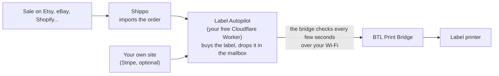

# BTL Label Autopilot

Make a sale, and the shipping label prints by itself, with what to pack written on it in big letters.

Works with Etsy, eBay, Shopify, WooCommerce, Amazon and the other stores [Shippo](https://goshippo.com) connects to, plus your own Stripe checkout. The only thing you buy is an ESP32-S3 board, a common microcontroller (about $6 to $10, once). The rest is free: it runs on a free Cloudflare account, and Shippo's free plan includes 30 labels a month (then 7¢ a label, plus postage, as of November 2026).

You need:

- an **ESP32-S3 board** (a common ~$6 to $10 microcontroller) plugged into your USB label printer, running the free **[BTL Print Bridge](https://github.com/BTLtech1/esp32-label-printer-bridge)** firmware, version **1.9.2 or newer**
- a **Shippo** account with your stores connected
- a free **Cloudflare** account

Video walkthrough: coming soon on [BTL's YouTube](https://www.youtube.com/@BTLPhotoTech). Step-by-step guide with pictures: coming soon on [btlstore.com](https://btlstore.com/guides/).

## How it works: a mailbox on the internet

1. **You make a sale.** Shippo imports the order from your store.
2. **Every 15 minutes, Label Autopilot asks Shippo for new paid orders.** For each one it buys the cheapest label under your price limit and drops it in its mailbox (a print queue).
3. **Your bridge checks the mailbox every few seconds** over your Wi-Fi, like a phone opening a website. If there's a label, it prints it and says "got it".

Your computer can be off. Nothing reaches into your home network, so there's no router setup. If the printer is unplugged or out of power, labels wait in the mailbox (up to 14 days) and print when it's back.

## Set it up (about 10 minutes)

### 1. Shippo

1. Sign up at [goshippo.com](https://goshippo.com) and add a payment method (labels are charged to it).
2. Connect your stores: **Settings → Stores** (Etsy, eBay, Shopify...).
3. Make a **Live** API token on Shippo's API page. It starts with `shippo_live_`. Keep the tab open.
4. Optional, for free test labels: also copy the **Test** token (`shippo_test_`).

### 2. Cloudflare

Click the button. Cloudflare asks you to sign in (or make a free account) and to link GitHub.

It asks for two things:

- **SHIPPO_API_KEY**: paste your Live Shippo token.
- **ADMIN_PASSWORD**: make up a password for your settings page.

Click **Deploy**. When it's done, open your new Worker's address (it ends in `.workers.dev`) and add `/admin` to the end. Sign in with your password (any username).

### 3. Settings page

Fill in:

- **Return address**, including email and phone (Shippo requires them).
- **Package**: size of your usual box or mailer, and its usual weight.
- **Never spend more than**: orders whose cheapest label costs more wait for you in Shippo instead.
- **Item codes**: if an item's title contains these words, its code prints big on the label (`gen 3` → `G3`). Add the packed weight too if you know it.
- **Shippo test key** (optional), for free test labels.

Tick **Buy and print labels by themselves** and **Save**. Only orders placed after this moment are touched, so old open orders never get surprise labels.

### 4. Bridge

The settings page shows a **Queue URL** and **Queue token** with Copy buttons. On your bridge's page, open **Settings** and paste them into **Queue URL** and **Queue token**, then save.

Click **Print a free test label** on the settings page. It should print within a few seconds, with `TEST` in the corner.

## What the label says

`2x G3, SD / ET` means: two G3s and one SD, from Etsy. Store tags (ET, EB, SH, AZ, WC, ST) can be changed or switched off on the settings page.

## Your own website (Stripe, optional)

If you sell through your own Stripe Checkout:

1. In Stripe, make a **restricted key** with only **Checkout Sessions: Read**.
2. Add a webhook at **Developers → Webhooks**: endpoint `https://<your worker>.workers.dev/stripe`, event `checkout.session.completed`. Copy its signing secret (`whsec_...`).
3. In Cloudflare, open your Worker → **Settings → Variables and Secrets**, and add two **Secrets**: `STRIPE_API_KEY` (the restricted key) and `STRIPE_WEBHOOK_SECRET` (the `whsec_` secret).

Website orders print within seconds, tagged `ST`. If a label can't be bought (over your limit, bad address), the order is put in Shippo for you to handle.

## Problems

| What you see | Fix |
| --- | --- |
| "address_from.email/phone must not be empty" | Fill in email and phone in your return address. |
| Bridge log says `Queue: HTTP 401` | The token on the bridge doesn't match. Copy it again from the settings page. |
| Bridge log says `Queue: HTTP 426` | Update the bridge firmware (its page → Firmware → Update now). |
| Label prints as gibberish or not at all | On the bridge's settings, set **Printer language** to match your printer (ZPL or TSPL). |
| An order didn't print | Check **Recent labels** on the settings page. "Not bought" says why. You can always buy it in Shippo by hand. |
| Label printed but blank | Out of labels, or the printer was asleep. Reprint from that order in Shippo (no extra charge). |

## Using an AI assistant?

Point it at [AGENTS.md](AGENTS.md). It explains how this works, what's safe to change and how to test without buying real labels.

## Privacy and safety

- Your keys are stored as Cloudflare secrets. The settings page is behind your password.
- Customer addresses go only between Shippo and your printer. Nothing is sent anywhere else.
- Old print jobs delete themselves after 14 days.

## Credits

Made by [BTL](https://btlstore.com). I designed and tested this; the code was written with help from AI (Claude). MIT license.
